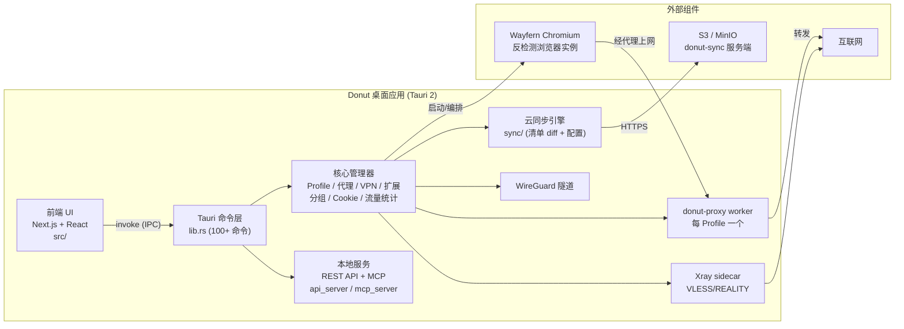
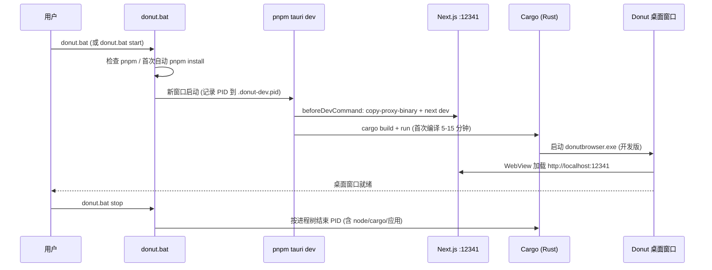
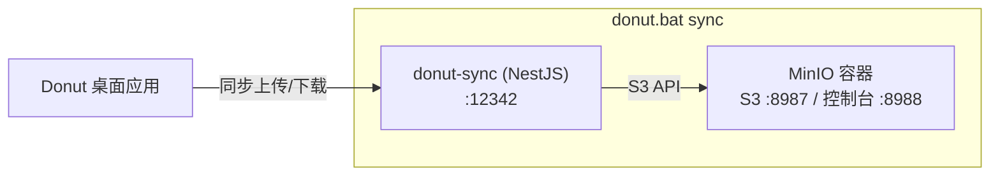

# Donut Browser 项目架构总结

> 生成时间:2026-10-25 · 版本 v0.29.5

## 1. 项目定位

**Donut Browser** 是一个开源反检测浏览器桌面应用,基于 Tauri 2 构建。每个浏览器 Profile 拥有独立指纹、Cookie、扩展和数据,配合代理 / VPN / DNS 去广告 / 云同步,面向多账号隔离与自动化场景。零遥测,AGPL-3.0 开源。

## 2. 技术栈

| 层 | 技术 | 位置 |
| --- | --- | --- |
| 前端 UI | Next.js 16 + React 19 + TypeScript + Tailwind 4 + shadcn/Radix | `src/` |
| 桌面壳/后端 | Rust + Tauri 2 (WebView2) | `src-tauri/` |
| 反检测内核 | Wayfern (Chromium fork, 指纹伪装) | 外部下载 |
| 本地代理 | donut-proxy (Rust sidecar, 每次启动一个 worker) | `src-tauri/src/proxy_server.rs` |
| 翻墙协议 | Xray-core sidecar (VLESS / XTLS Vision / REALITY) | `src-tauri/src/xray/` |
| VPN | WireGuard 隧道 | `src-tauri/src/vpn/` |
| 云同步服务端 | NestJS (可自托管) | `donut-sync/` |
| 对象存储 | S3 / MinIO | docker-compose |
| 对外集成 | REST API (utoipa) + MCP 服务 | `api_server.rs` / `mcp_server.rs` |
| E2E 测试 | 自研 WebDriver harness | `e2e/` |

## 3. 仓库结构

```text
donutbrowser/
├── src/                  # Next.js 前端 (app/ components/ hooks/ i18n/ lib/)
├── src-tauri/            # Rust 后端 (Tauri 命令、管理器、sidecar、REST/MCP)
│   └── src/
│       ├── lib.rs        # 100+ Tauri 命令注册
│       ├── browser.rs / browser_runner.rs   # 浏览器下载、启动、进程编排
│       ├── profile/      # Profile CRUD 与元数据
│       ├── proxy_manager.rs / proxy_server.rs   # 代理生命周期 + donut-proxy
│       ├── xray/ + xray_worker_runner.rs        # Xray sidecar
│       ├── vpn/          # WireGuard
│       ├── sync/         # 云同步引擎 (清单 diff + 配置 JSON)
│       ├── api_server.rs / mcp_server.rs        # REST + MCP
│       └── ...
├── donut-sync/           # NestJS 同步服务端 (自托管)
├── e2e/                  # 原生 UI/集成/浏览器 E2E
├── docs/                 # 项目文档
├── scripts/              # dev.sh 等开发脚本
└── donut.bat             # Windows 一键启动/停止 (本仓库新增)
```

## 4. 总体架构图



要点:

- 前端不直接访问系统能力,一切通过 Tauri IPC 调用 Rust 命令。
- 每个启动的 Profile 都会拉起独立的 donut-proxy worker,浏览器流量先经本地代理再走上游代理/VPN,实现按 Profile 隔离路由。
- REST API 与 MCP 随应用启动,供 Claude / 自动化工具控制 Profile(端口 51080)。
- 同步分两类:Profile 文件按内容哈希清单增量上传;配置类实体(代理、VPN、分组等)整包 JSON,以 `updated_at` 最新写入优先。

## 5. 开发环境启动流程



`pnpm tauri dev` 经 `scripts/run-with-env.mjs` 包装,自动附加 `--no-watch --features self-hosted-browser-automation`(启用本地自动化授权,避免反复重编译)。

## 6. 同步服务栈 (可选)



首次使用需配置 `donut-sync/.env`(参照 `.env.example`,含 `SYNC_TOKEN`、S3 密钥等)。

## 7. 端口与数据目录

| 端口/路径 | 用途 |
| --- | --- |
| 12341 | Next.js 前端 (开发) |
| 12342 | donut-sync 服务端 |
| 51080 | MCP 服务 (随应用启动) |
| 8987 / 8988 | MinIO S3 / 控制台 |
| `%LOCALAPPDATA%\DonutBrowserDev` | 开发版数据目录 |
| `%LOCALAPPDATA%\DonutBrowser` | 生产版数据目录 (与开发版隔离) |
| `%LOCALAPPDATA%\com.donutbrowser\logs\DonutBrowserDev.log` | 开发日志 |

## 8. 一键启动 / 停止

Windows 下在项目根目录执行(可双击):

```bat
donut.bat           :: 启动 Donut 桌面开发版 (等同 donut.bat start)
donut.bat stop      :: 停止开发版 (含同步服务栈, 如在运行)
donut.bat restart   :: 重启
donut.bat status    :: 查看端口/进程状态
donut.bat sync      :: 启动 MinIO + donut-sync (需要 Docker)
donut.bat sync-stop :: 停止同步服务栈
donut.bat help      :: 帮助
```

手动方式(等价命令):

```powershell
pnpm install        # 首次
pnpm tauri dev      # 启动桌面开发版, Ctrl+C 停止
```

Linux/macOS/Git Bash 可用 `bash scripts/dev.sh` 一键启动全栈(MinIO + donut-sync + Tauri)。
